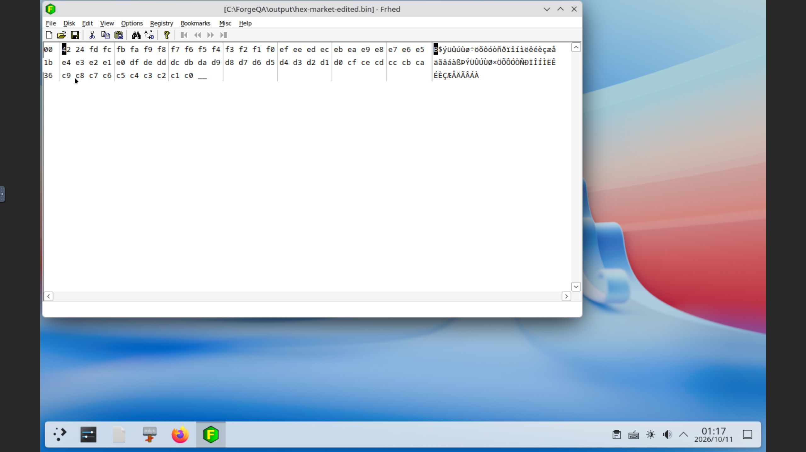
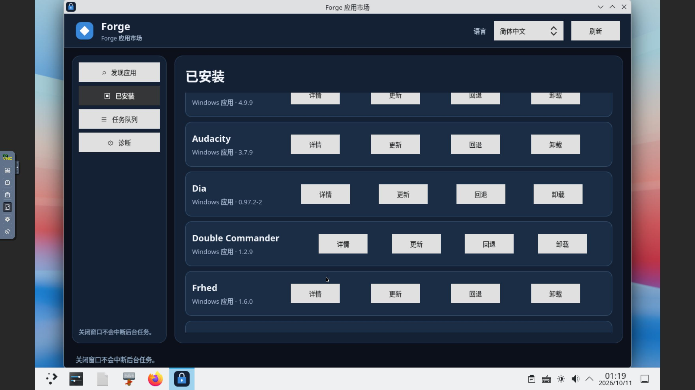

# Windows 滚动适配：Frhed 1.6.0（2026-10-11）

本轮新增 1 款受限兼容应用，Windows 累计 **26/1000**。原代次及独立市场代次均完成 64 字节二进制打开、指定字节覆盖、GUI Save As 与新进程显式重开，随后精确回滚并正常重启 Core/Store。12 项既有阻塞保留。Ubuntu 独立累计 2 款；Flatpak 下载缓存保留，本轮未切换虚拟机或重试。

## 来源与安装

使用官方固定 [1.6.0 稳定版目录](https://sourceforge.net/projects/frhed/files/1.%20Stable%20Releases/1.6.0/) 中的 Frhed-1.6.0-Setup.exe，725,124 字节，SHA-256 941b6b7c436653a7e4c0c55ee5180c343e4b9da86b080530c3b4af8092f5c4e0。对应 Frhed-1.6.0-src.zip 为 1,004,237 字节，SHA-256 b9c394ebeb18bcd33fcb2255f1b25d742bb9ef73a59334913b39dfff7c7d16c0。实测官方 HTTPS 下载字节固定并在客体接收后再次核对，不声称上游公布密码学摘要、Authenticode 或可复现构建。

固定源码 version.h 明确授予 GPL 第 2 版或后续版本，主程序标记 GPL-2.0-or-later。安装后的 Docs/GPL.txt 与固定源码程序及 NSIS 许可成员字节一致，SHA-256 11b20503cb9fd1085088945d07084ec6d8da3c0a91f12d48b06d189a93b12507。根目录 GPL 的换行、标题大小写和应用示例占位符不同，归一化后仍不同的事实保留。完整捆绑组件（包括 VC80 运行库）的许可闭包未核验。详见 [来源记录](evidence/2026-10-11-frhed-source.json) 与 [原代次独立审查](evidence/2026-10-11-frhed-original-review.json)。

NSIS 配方为 /S 和末尾 /D=C:\Frhed，实际 About 显示 1.6.0。受管安装代次 gen-job-1791680907933-1 的 Frhed/frhed.exe 为 61,440 字节，SHA-256 8ed1da5fafb4a02618fa2a51ae43e6cf34a7777938d85fba369c8650a48c2544；安装任务退出 0，代次 ready。现有固定 managed-msi-v10 Core 和 managed-msi-v2 Store 继续使用，新增 Provider v2 源码未部署或 GUI 验收。

## 实际 GUI 与文件

原代次打开 ASCII 路径 hex-original.bin（64 字节，00..3F），在十六进制区将偏移 0、1 改为 A5 FF，通过 File/Save As 保存到 output/hex-edited.bin。正常退出后新进程从空文档显式重开该输出。磁盘文件恰好只改变两个指定字节，64 字节长度及其余 62 字节保持，原输入不变。输出 SHA-256 为 6fe36a18018f4642e320cd7b62966d2c1561ceaf2ee9fef33ebce1d4b51c88ca。

独立市场代次 gen-job-1791681323784-4 使用另一组输入 hex-market.bin（FF..C0），偏移 0、1 改为 42 24，GUI Save As 输出 hex-market-edited.bin，正常退出及新进程显式重开通过。实际输出 SHA-256 为 3ff70c430f55ac033df9d1e6cd0e5d1cd2392e881a131cf32fdc1f50c9361232，64 字节且其余字节不变，原市场输入保持。未从原代次复制配置或输出。四个实际输入/输出 .bin 文件作为证据保留原字节，.gitattributes 禁用文本转换。

## 本地市场、回滚与重启

candidate-v27/tuf 使用现有 root 1，在线 targets/snapshot/timestamp 前进到 36。28 条记录包含 26 款应用及 2 项夹具。原 GUI 证明先冻结，SHA-256 91d9be5046ed652fdd3586c72118da512bb849d15005d0137562bd39fa883a55，绑定来源 SHA-256 65bfe259ab4bcb67603d2c80c39645d8c0a7a83194402fe0a37ecd808d64efec。其历史“市场待执行”保持不变，后续 [发布记录](evidence/2026-10-11-frhed-publication.json) 单独记录完成。旧全部签名目标摘要及 MPC-HC 原/更正、LazPaint、AkelPad 证明保持。显式现有 trusted root 的 tuftool 0.17 验签下载实际目录、收据和安装包通过，无跳过签名或过期校验。

预缓存同版本更新 41aa46b3-49cd-423b-9752-43580fc3c80a 与回滚 bb7db551-bf2d-49f0-bec9-5c86da4d140c 均通过 Store IPC enqueue 提交并 succeeded；未声称通过 GUI 按钮触发。更新建立独立新代次，回滚精确选中原代次，随后新进程显式重开原输出。两个 ready 代次与所有输入/输出保留。

正常 Core/Store 重启前所有任务终态。重启后 198 条核心完整任务、69 条市场完整 SQL 行、完整市场快照、全部配置与代次、签名信任、服务保护字段保持；known time 单调前进。原有 191 条核心任务与 67 条市场行的完整字段保持，旧 AkelPad 两套输入/输出、LazPaint 四个输出与 MPC-HC 输出摘要，以及“不自动息屏”配置均核对通过。仅一个 4 GiB Windows 测试虚拟机运行，Ubuntu 虚拟机未启动，正常认证及锁屏设置未修改。

市场 GUI 实际显示 Frhed 1.6.0、GPL-2.0-or-later、tested、冻结证据引用和仅 ASCII/64 字节范围，已安装行及回滚控件可见。

私有完整检查点 frhed-20261011/after-restart.json，最新只读核对助手 L:/project/FOS/.transfer/rolling-current-state-20261011.py；旧固定总数脚本只代表历史。私有复核包与签名私钥、密码、凭据不入库。

[最终独立审查](evidence/2026-10-11-frhed-review.json) 通过，无阻塞或重要问题；独立核对完整检查点、实际文件、截图、签名目录及暂存字节，并使用原可信根完成 tuftool 验签下载。审查未操作或重新读取运行中的客体。[最终验证](evidence/2026-10-11-frhed-final-verification.json) 记录本机字节检查与最新客体只读核对结果。

## 失败记录与验收边界

最初许可辅助脚本错误要求全部 GPL 文件字节相同；读回辅助脚本缩进错误；误读 Ctrl+J 为 Ctrl+I 打开了 View Settings 并取消；回滚辅助记录沿用了旧日期标签，原记录保留，另作日期更正；本机 Python 3.9 不接受纳秒 RFC3339 时间，改为 Decimal 保留精度核对单调性。均保留于 [失败记录](evidence/2026-10-11-frhed-failures.json)，未确认产品缺陷，产品代码未修改。

仅覆盖 64 字节二进制与 ASCII 路径基本操作。中文路径和直接中文输入、大型或部分文件、物理磁盘访问、模板、搜索、插件和高级编辑均未验收。客体联网下载、新机器注册、配置迁移及跨版本升级未验收；完整捆绑组件许可闭包未核验。受限范围已显示在市场摘要和台账，不能据此声称完整编辑器支持。
