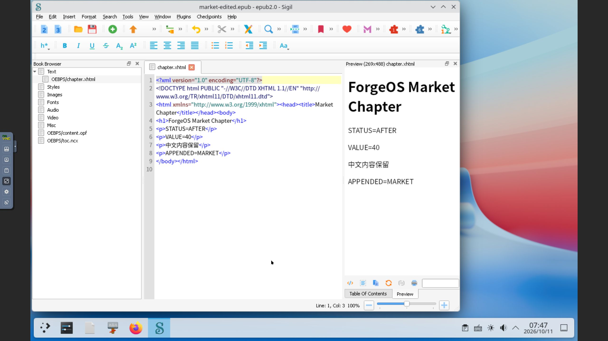

# Windows 滚动适配：Sigil 2.6.2

2026-10-11，Windows 累计 **33/1000**；原有 32 个独立应用记录、12 项未解决候选及已解决候选历史保留。合成 EPUB 是输入夹具，不计独立应用。

Sigil 本轮通过两个小型、单章节 EPUB2 的中文名打开、代码视图普通 BEFORE→AFTER 替换、ASCII 段落追加、实际预览（含既有中文内容）、GUI Save As 到 ASCII 路径和显式新进程重开。独立市场代次重复该流程；Store IPC 预缓存同版本更新、精确原代次回滚及 Core/Store 正常重启通过。只接受上述有限能力。

## 来源与许可

使用[官方发布页的固定 2.6.2 安装包](https://github.com/Sigil-Ebook/Sigil/releases/tag/2.6.2)，未用“最新”移动下载地址。`Sigil-2.6.2-Windows-x64-Setup.exe` 实际 133608315 字节，SHA-256 `7761dc54a4f100abff116c30e4aeb3ffbd2ad30277e65a1a5c0107e5cd11707e`，与官方 release API 的固定资产摘要一致。

固定 tag 提交 `4a2e386a7c30026350232e97b7ec4c3ecd6519d4` 的源码归档实际 19468205 字节，SHA-256 `1aca354f8f50f9e6f19bb4331b5972c5ebe9cd9fabd3e3253515380237fd6325`。`src/main.cpp` 核实主程序 GPL-3.0-or-later。安装 `COPYING.txt` 35821 字节，与固定源 `COPYING` 35147 字节经 **674 处 CRLF 标准化**后同文，原字节不同。完整 Qt/Chromium/Python/图标和捆绑许可闭包、Authenticode/OpenPGP 验证、构建可复现性未核验。固定源码安装脚本核对后选 `main` 组件，省略可选桌面图标和默认 EPUB 关联组件；安装器仍创建 OpenWith 等登记，不声称清除了全部文件关联。

## 预览修复与保留的失败

默认代次 `gen-job-1791703450509-1` 的两次托管进程 `job-1791703529975-2`、`job-1791703779077-3` 能编辑保存代码，但预览空白；正常退出 0 不计 GUI 验收。仅在请求层增加 `QTWEBENGINE_CHROMIUM_FLAGS=--disable-gpu` 的诊断进程 `job-1791703873301-4` 实际显示中文与编辑内容。[Qt 官方说明](https://doc.qt.io/qt-6.5/qtwebengine-debugging.html)记录了该环境变量及关闭 GPU 加速参数。具体 Wine/Qt/Chromium/GPU 缺陷函数尚未定位。

正式修复复用原生 `launcher.environment` 字段，安装新代次后再测试。冻结定义 SHA-256 `3d9038b8b127ef1a5466bae1a8e60263fc46b00a98bdfcbaf89153dbea3019da`。无 Core 代码、全局 context、程序/DLL/runtime/字体或工作目录变更，也未使用 `--no-sandbox` 等绕过保护参数。诊断代次及其配置、数据摘要保持，不当作正式代次或独立应用。

默认重开期间，误以为预览百分比可编辑，Ctrl+A/100 实际替换了代码视图。两次 Undo 后正常 Quit/Discard，磁盘输出字节核对不变；截图 09/10 保留，不声称缩放测试成功或排除了缩放原因。初始更新通知关闭后的桌面是加载过渡，截图 02 不作崩溃或通过证据。新代次首次启动的版本通知均正常选择 No；无人值守启动未验收，未改变账号认证、锁屏和不自动息屏配置。

## 正式 GUI 与本地市场生命周期

| 环节 | 原正式代次 | 独立市场代次 |
|---|---|---|
| 安装 | `job-1791703952208-5` | `job-1791704634969-8` |
| 代次 | `gen-job-1791703952208-5` | `gen-job-1791704634969-8` |
| 编辑、预览、GUI 保存 | `job-1791704000965-6` | `job-1791704674184-9` |
| 显式新进程重开 | `job-1791704116192-7` | `job-1791704785969-10` |
| 输入/输出大小 | 1564 / 1685 字节 | 1559 / 1681 字节 |

两份输入原字节保持；输出分别含 `VALUE=21/40`、`STATUS=AFTER`、`APPENDED=ORIGINAL/MARKET` 和既有中文。实际 ZIP CRC、唯一 XHTML 的 XML/body 内容及全文件摘要核实。输入使用小型合成 EPUB，未运行 EPUBCheck，不能称完整 EPUB 标准符合性验证。

安装 `Sigil.exe` SHA-256 `d9deafca1b85e343662d0b16aed24f53b6567e64e06dba673fa7bf1a402c9b3e`；WebEngine DLL/子进程、许可摘要在默认、正式及市场代次核对一致。五次正式 GUI（含回滚后 `job-1791704863184-11`）均正常 Quit，退出 0，并记录 wineserver 正常停止。

本地市场使用 **candidate-v34 / root 1 / 在线角色 43**，35 条目录记录 = 33 个独立 Windows 应用 + 2 个排除夹具。68 个实际签名目标、39 份公共目录文件已核对。原 root 字节及角色 42 的全部非目录目标摘要继承；旧签名目录保留。使用旧可信 root 通过 tuftool 0.17 下载验证目录、验收收据及安装包，无不安全/过期绕过参数。

Store IPC 更新任务 `e9a3838f-2948-4fe4-a2c5-9e08cf163e5a` 和回滚任务 `a1f8587f-13d7-42b2-8828-12ec83c317e6` 成功。回滚前 **256 Core / 82 Store** 完整检查点先保存读回后提交；回滚后 **256/83** 旧任务全部字段保持，精确恢复原正式代次。回滚 GUI 正常退出后，重启前后 **257/83** 全字段精确一致，包括完整 SQLite 历史、代次记录、正式配置和签名信任；最近 64 条 IPC 摘要不替代全历史。更新与回滚使用 IPC，不声称 GUI 按钮验收。

私有完整检查点 `sigil-20261011/after-restart.json` SHA-256 `5aeb6b163c874fb207722eaaceee5ad434156a5e5a999a0b8af5b104e35a11c9`。后续只读核对使用 `L:/project/FOS/.transfer/rolling-current-state-sigil-20261011.py`，必须通过严格 SSH 操作助手在客体执行。旧固定数量助手仅表示历史。保留 root 信任，不回退或删除缓存；完整私有检查点、签名私钥和凭据不入库。

## 边界与证据

EPUB3、多章节、CSS/图像/音视频、插件/Python、元数据/目录编辑、打印、大文件、直接中文键盘输入及高级功能未验收。客体联网下载、新机器注册、配置迁移和跨版本升级未验收。数据核对覆盖既有固定验收文件、诊断 pins 和本轮输入/输出/程序/许可/Qt/config/registry，不声称遍历全部应用文件系统。计划中的 network deny 也不当作真实网络隔离证明。现有 Ubuntu 两款独立记账，Flatpak 下载阻塞与缓存保持，未启动第二台虚拟机。

原来源、GUI、验收收据的冻结字节及市场待执行阶段标签保持；后续完成在[发布记录](evidence/2026-10-11-sigil-publication.json)、[独立市场 GUI](evidence/2026-10-11-sigil-market-gui.json)、[正常重启证据](evidence/2026-10-11-sigil-runtime-recovery.json)、[失败记录](evidence/2026-10-11-sigil-failures.json)和[只读核对](evidence/2026-10-11-sigil-current-state.json)单独记录。

